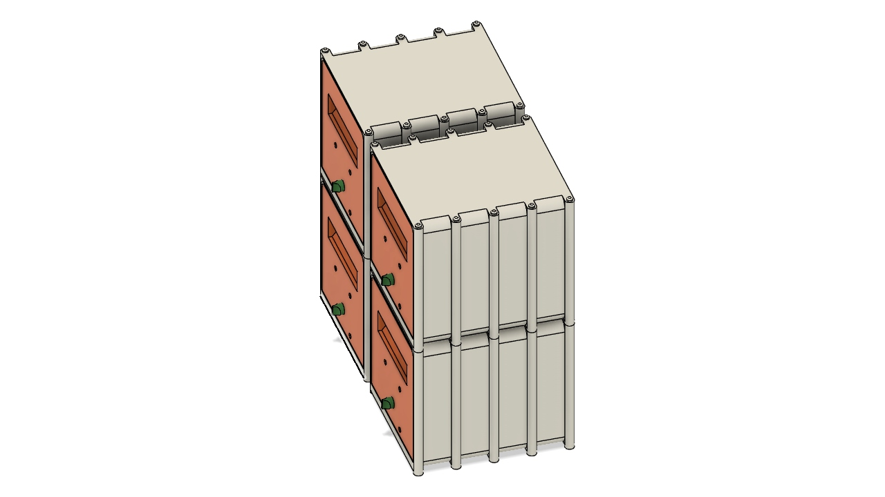
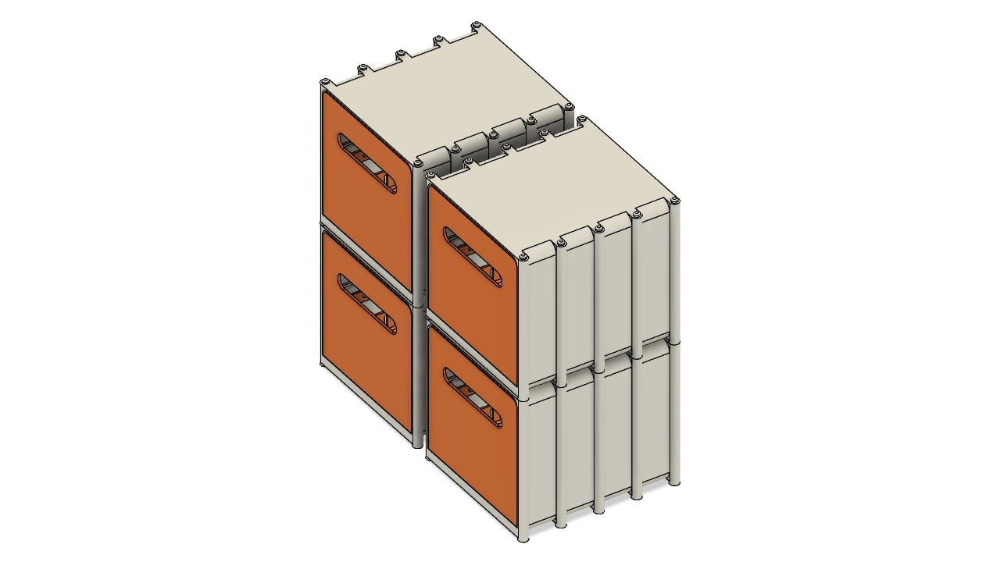

# Desk Shelf Organizer

A modular desk drawer organizer designed in Autodesk Fusion, with lockable and non-lockable versions. Each version has individual STEP components and an assembly video showing how the parts fit together.

| Lockable version | Non-lockable version |
| :---: | :---: |
|  |  |
| [Watch the lockable assembly video](lockable/assembly.mp4) | [Watch the non-lockable assembly video](non-lockable/assembly.mp4) |

## CAD components

Every STEP file contains one component. The drawer shell is shared by both versions and is included in each folder so either version can be downloaded on its own. All STEP geometry uses millimetres.

### Lockable version

| Component | Download |
| --- | --- |
| Drawer shell | [Drawer Shell.step](lockable/Drawer%20Shell.step) |
| Lockable drawer | [Drawer.step](lockable/Drawer.step) |
| Helical rack | [Helical rack STEP](lockable/Healical%20Rack%20%2850.0mm%20R%400.00%20m%3D1.25%29.step) |
| Lock casing | [Lock Casing.step](lockable/Lock%20Casing.step) |
| Spur gear, 16 teeth | [Spur gear STEP](lockable/Spur%20Gear%20%2816%20teeth%29.step) |

### Non-lockable version

| Component | Download |
| --- | --- |
| Drawer shell | [Drawer Shell.step](non-lockable/Drawer%20Shell.step) |
| Conventional drawer/door | [Large Conventional Door.step](non-lockable/Large%20Conventional%20Door.step) |

## Assembly videos

The videos show assembly, drawer opening and closing, an exploded view and reassembly, then four modules arranged as two stacks side by side. Both use a white background.

- **Lockable:** assembly of the drawer and locking mechanism, followed by a four-unit arrangement.
- **Non-lockable:** assembly of the shell and conventional drawer/door, followed by a four-unit arrangement.

The videos demonstrate the assembly visually. Standard nuts and screws shown in the lockable demonstration are not included among the exported STEP components.

## Using the files

Download the components for the version you want. Open the STEP files in a CAD application or a slicer that supports STEP; if required, export each component as STL or 3MF for your printing workflow. Printer settings and pre-sliced files are not included.

## License

No license has been specified for this project.
